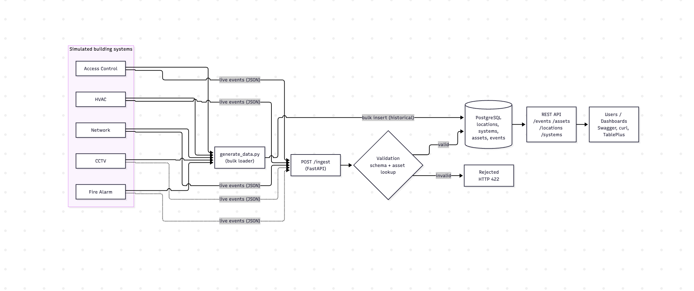
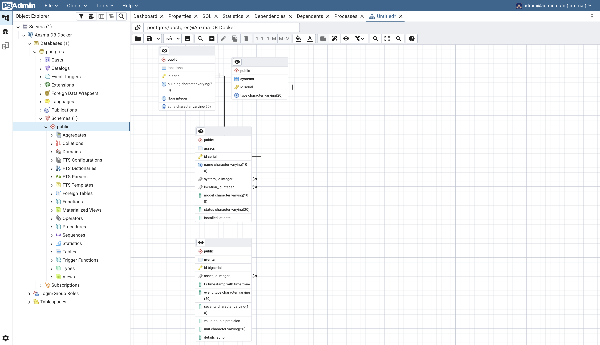

# Building Data Platform: Data Engineering & System Integration

Simulated commercial-building dataset (HVAC, Network, Access Control, CCTV, Fire Alarm) stored in a normalized PostgreSQL schema and exposed through a documented REST API.

**Success criterion:** retrieve reliable data by **asset**, **location**, **timestamp** and **system type**.

## Architecture / Data Flow Diagram



- **Historical load:** `generate_data.py` writes 24h+ of simulated events straight to the database.
- **Live ingestion:** any source can `POST /ingest`; events are validated before being stored (the whole batch is rejected if any asset is unknown).
- **Retrieval:** the REST API joins events with assets, systems and locations so every record comes back with full context.

## ER Diagram



Design notes:
- Systems and locations are stored once; assets reference them by foreign key (no duplication).
- `events.details` is JSONB for system-specific attributes (e.g. `card_id` for Access, `humidity` for HVAC) without a table per system.
- Index `(asset_id, ts)` serves the most common query: one asset over a time range. Extra indexes on `ts` and `event_type`.
- Timestamps are `TIMESTAMPTZ` (stored in UTC).

## Project Structure

```
.
├── docs/
│   ├── Data-Flow-Diagram.png
│   └── ER-Diagram.png
├── .env                 # local DB credentials (git-ignored, create it yourself)
├── .gitignore
├── App.py               # FastAPI: ingestion + retrieval endpoints
├── generateData.py      # simulated data generator / bulk loader
├── README.md
├── requirements.txt
└── schema.sql           # tables + indexes
```

## Setup

1. **Database:** create a PostgreSQL database and run the schema.sql (tables `locations`, `systems`, `assets`, `events` + indexes).
2. **Install:**
   ```bash
   pip install -r requirements.txt
   ```
3. **Configure the connection:**

   Create a file named .env in the project root with the following content:
   ```
   PGHOST=localhost
   PGPORT=5432
   PGDATABASE=postgres
   PGUSER=postgres
   PGPASSWORD=your_password_here
   ```
   .env is listed in .gitignore, so credentials are never committed. Real environment variables (e.g. export PGPASSWORD=...) also work and take precedence over .env.
5. **Generate sample data** (default 48h, minimum 24h):
   ```bash
   python generate_data.py --reset
   # options: --hours 24  --seed 42
   ```
6. **Run the API** (documented API endpoints via Swagger UI):
   ```bash
   uvicorn app:app --reload
   ```
   Swagger UI: http://127.0.0.1:8000/docs

## Simulated Data

| System | Events generated |
|---|---|
| HVAC | temperature + humidity every 5 min (day/night setpoints), `HIGH_TEMPERATURE` spikes, `FILTER_FAULT` |
| NETWORK | bandwidth every 5 min, `LINK_DOWN`/`LINK_UP` outages with downtime, hourly `UPTIME_REPORT` |
| ACCESS | `ACCESS_GRANTED` / `ACCESS_DENIED` (higher denial at night and on the server-room door), `DOOR_HELD_OPEN`, `DOOR_FORCED` |
| CCTV | `MOTION_DETECTED` (more during working hours), `CAMERA_OFFLINE`/`ONLINE` |
| FIRE_ALARM | hourly `PANEL_HEARTBEAT`, false `SMOKE_DETECTED` + `ALARM_RESET`, `BATTERY_LOW` |

A small share of anomalies is injected on purpose so the data behaves realistically.

Verify volume and time span:

```sql
SELECT s.type, COUNT(*) AS events, MIN(e.ts) AS first_ts, MAX(e.ts) AS last_ts
FROM events e
JOIN assets a  ON a.id = e.asset_id
JOIN systems s ON s.id = a.system_id
GROUP BY s.type ORDER BY s.type;
```

## API Reference

| Method | Endpoint | Description |
|---|---|---|
| POST | `/ingest` | Ingest 1 to 5000 events (validated, atomic) |
| GET | `/events` | Query events; filters below |
| GET | `/assets/{id}/events` | Events for one asset |
| GET | `/assets` | List assets (`system_type`, `location_id`) |
| GET | `/assets/{id}` | Single asset |
| GET | `/locations` | List locations (`building`, `floor`) |
| GET | `/systems` | List systems |
| GET | `/health` | Service/DB check |

### `GET /events` filters

| Param | Type | Notes |
|---|---|---|
| `asset_id` | int | |
| `location_id` | int | |
| `system_type` | enum | `HVAC`, `NETWORK`, `ACCESS`, `CCTV`, `FIRE_ALARM` |
| `from`, `to` | ISO-8601 | inclusive range |
| `event_type` | string | e.g. `ACCESS_DENIED` |
| `severity` | enum | `INFO`, `WARNING`, `CRITICAL` |
| `limit`, `offset` | int | default 100, max 1000 |
| `order` | `asc`/`desc` | by timestamp, default `desc` |

Response: `{ "total", "limit", "offset", "items": [ { id, ts, event_type, severity, value, unit, details, asset_id, asset_name, system_type, location_id, building, floor, zone } ] }`

### Examples

```bash
# by system type
curl "http://127.0.0.1:8000/events?system_type=HVAC&limit=5"

# by location
curl "http://127.0.0.1:8000/events?location_id=1"

# by asset + time range (use a range inside your generated data, see first_ts/last_ts above)
curl "http://127.0.0.1:8000/assets/1/events?from=2026-11-01T00:00:00Z&to=2026-11-02T00:00:00Z"

# combined
curl "http://127.0.0.1:8000/events?system_type=ACCESS&severity=WARNING&location_id=1"

# ingest (timestamp = now, since future timestamps are rejected)
TS=$(date -u +%Y-%m-%dT%H:%M:%SZ)
curl -X POST http://127.0.0.1:8000/ingest -H "Content-Type: application/json" -d '{
  "events": [{
    "asset_name": "HVAC-AHU-01",
    "ts": "'"$TS"'",
    "event_type": "temperature_reading",
    "value": 23.4, "unit": "°C",
    "details": {"humidity": 47}
  }]
}'
```

### Ingestion validation rules

- `asset_id` or `asset_name` required and must exist
- `ts` ISO-8601; naive values are treated as UTC; more than 5 minutes in the future is rejected
- `severity` must be `INFO`, `WARNING` or `CRITICAL`
- `event_type` is normalized to `UPPER_SNAKE_CASE`; other characters are rejected
- Invalid batch returns HTTP 422 and nothing is stored

## Known Limitations / Next Steps

- No authentication on the API. 
- `generateData.py` loads directly into the DB rather than   through `/ingest`.
- Partitioning of `events` by time would be the next step for larger volumes.
